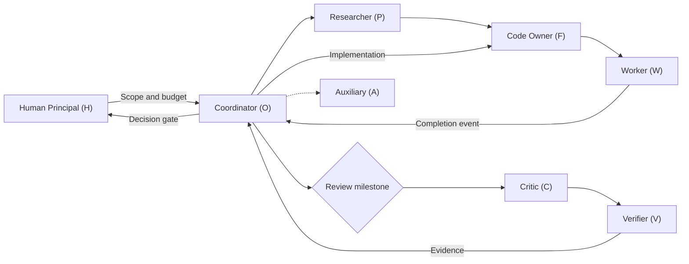

# engineering-multi-ai-skills

[](LICENSE)

Practical skills and a file-based workflow for engineering teams using multiple AI agents. Works with software, infrastructure, data pipelines, benchmarks and other engineering tasks. No model, vendor, machine or programming language is required.



Use one agent for ordinary work. Add separate implementers, reviewers or verifiers when independent work will resolve a concrete uncertainty. A skill does not create agents or grant permissions: use delegation and tool access already authorized in your environment.

The diagram shows the optional **governed profile**: human decision gates, event-driven milestones, physical-node affinity and bounded worker repairs. The basic quickstart below uses I as a compatibility alias for F and needs no scheduler.

## 3-Minute Quickstart

**You need:** Git, Python 3.10+ and an AI coding assistant that can read local files. No API key or multi-agent runner configuration is needed for this walkthrough.

### 1. Clone and preview your first thread

Run these commands in a terminal:

```shell
git clone https://github.com/TianMingKanae/engineering-multi-ai-skills.git
cd engineering-multi-ai-skills
python scripts/dispatch.py --root examples/quickstart/project --role I
```

Expected output:

```text
PENDING context/discuss/normalize-label.md
```

The [sample project](examples/quickstart/project/) contains a small label-normalization bug, acceptance tests and an assigned thread. Preview reads that assignment without starting a model or writing state.

### 2. Say this to your AI

Open your coding assistant in the cloned repository and paste:

```text
Act as the implementer (I) for the quickstart only.
Read skills/engineering-plan/SKILL.md, skills/worker-task/SKILL.md,
examples/quickstart/project/AGENTS.md, and
examples/quickstart/project/context/discuss/normalize-label.md.
Fix the assigned bug in examples/quickstart/project/labels.py.
Run the supplied tests without changing their expectations.
Append an I entry with the command and observed result to the thread,
then set its frontmatter owner to C. Do not start other agents.
```

This loads the relevant skills explicitly; you can install them in your host's skill directory later.

### 3. Check the result

Back in your terminal:

```shell
python -m unittest discover -s examples/quickstart/project -v
python scripts/dispatch.py --root examples/quickstart/project --role C
```

After the fix, expect **4 passing tests** and `PENDING context/discuss/normalize-label.md` for C. The tests intentionally fail before the fix. You have now completed a bounded task and handed off evidence through a real thread.

For independent review, open a fresh assistant session and say: "Act as C. Read skills/critic-review/SKILL.md and the quickstart thread, inspect the patch and rerun its tests. Append your findings; if acceptance criteria pass, set status to resolved and owner to O." Changing role in the implementer's existing session does not provide independent verification.

## Skills

| Skill | Use it for |
|---|---|
| [multi-agent-collaboration](skills/multi-agent-collaboration/SKILL.md) | Split a task, define ownership, hand off evidence and converge on a decision. |
| [engineering-plan](skills/engineering-plan/SKILL.md) | Define scope, acceptance criteria, validation and rollback before substantial implementation or an experiment. |
| [critic-review](skills/critic-review/SKILL.md) | Review correctness, failure handling, security, performance and reported evidence. |
| [worker-task](skills/worker-task/SKILL.md) | Execute a bounded assigned job, capture outputs and report reproducible failures. |
| [claim-ledger](skills/claim-ledger/SKILL.md) | Keep engineering conclusions tied to evidence, status and limits. |
| [engineering-governance](skills/engineering-governance/SKILL.md) | Apply H decision gates, milestone review, node migration, fix quotas and blind verification. |

`skills/` holds the canonical copies. Copy selected folders into your agent's configured skill directory. For example, to install into a project's Claude skill directory:

```powershell
$destination = 'C:\path\to\your-project\.claude\skills'
New-Item -ItemType Directory -Force $destination | Out-Null
Copy-Item -Recurse .\skills\* $destination
```

Review existing same-named skills before copying. Other hosts can use the same SKILL.md instructions through their loader or as explicit task context. Select only skills relevant to the task.

## Collaboration starter

[templates/project/](templates/project/) contains AGENTS.md, CLAUDE.md and empty context records to adapt in a target repository. Merge the instruction files with existing project rules. Keep the relative layout of `context/`; create one discussion file per topic from [thread.md](templates/thread.md).

| Role | Owns |
|---|---|
| H — human principal | Final project scope, resource ceilings and trusted override decisions. |
| O — coordinator | Scope, ownership, integration and user-facing updates. |
| F — primary code owner | Production code and focused tests; I is the basic-mode alias. |
| P — researcher | Sources, options and design rationale on a suitably entitled node. |
| C — reviewer | Independent review of the patch and evidence. |
| V — blind verifier | Independent scripts from raw artifacts and a separate specification. |
| W — worker | Exact assigned commands and artifact collection. |
| A — auxiliary | Explicit support work without production-code authority by default. |

These are responsibilities, not mandatory sessions. Combine roles when independence is unnecessary. In basic mode, O → P/F → C → V → O is one possible flow. In the governed profile, O batches C/V work at Pilot Readout, Pre-Main Launch and CLAIMS Entry; routine jobs do not trigger repeated reviews. Only O/F own production changes, with a narrow recorded W mechanical-fix exception. Use isolated clones/worktrees for concurrent writes; blind V needs a separate minimal artifact packet, not a source-visible worktree.

### Governance patterns and before/after

| Concern | Before | Governed profile |
|---|---|---|
| Decision deadlock | Agents debate without a final owner | `owner: H`, blocked branch, trusted human release |
| Idle model cost | Timed model wakeups and repeated micro-reviews | Completion/scheduler receipts; three batch review gates |
| Wrong node / migration race | Assume tools and network access; resume twice | Capability preflight, target READY, single-writer lease, STARTED |
| Role overreach / correlated checks | Unbounded worker repairs and shared solver logic | O/F production ownership, task-level fix quota, blind V packet |

Read the [governance comparison and adoption guide](docs/governance.md) and the [four pattern modules](skills/engineering-governance/SKILL.md). H is the highest project authority within host constraints; a human waiver never changes the evidence. Token savings above 80% are a measurement target, not a demonstrated result of this repository.

### Example: duplicate webhook delivery

1. O opens a thread: a repeated event must cause one database write. Assign I and define the test and owned files.
2. I implements the idempotency check, runs a focused test and hands C the diff plus output.
3. C checks concurrent deliveries, transaction boundaries and error paths. Return any defect to I.
4. V independently reproduces the concurrency check when risk warrants it. O records the conclusion and reports the observed behavior and limits.

See [workflow.md](docs/workflow.md) for the thread contract and failure handling.

## Optional execution tools

Python 3.10+ and its standard library are sufficient. Tools accept `--root` and never configure credentials, synchronize Git, commit, push or change sandbox settings.

### Preview or dispatch assigned work

```powershell
python scripts/dispatch.py --root C:\path\to\project --role I
```

This previews open threads owned by I, without writing state or starting a model. To connect an agent CLI, copy [runner.example.json](examples/runner.example.json), replace its argument array with your installed CLI's supported syntax, and use:

```powershell
python scripts/dispatch.py --root C:\path\to\project --role I --config C:\path\to\runner.json --execute
```

Add `--watch --poll-seconds 300` to poll local files. Arrange synchronization separately from an idle clone; never pull files underneath active jobs. `{prompt}` is substituted into one argument without shell evaluation. No CLI flags or model names are assumed. Each thread is dispatched once per successful input fingerprint; failures get at most `max_attempts` total attempts, with no retry in the same poll. A successful runner must append its role entry or hand the thread to another owner. State, logs and a per-role lock live in `.multi-ai/`. Only one dispatcher per role and project may run at once.

For governed jobs, prefer a one-shot call from an authorized scheduler with `--mode milestone --node compute-node`. H cannot be dispatched in either mode. A thread with a `node` field is skipped without a matching `--node`. Milestone Mode requires a matching event receipt; C/V additionally require one of the three milestones and a scheduler receipt. See the [receipt schema and trigger contract](skills/engineering-governance/references/milestone-mode.md). File polling itself makes no idle model calls; these routing checks do not enforce file write ACLs, authenticate H or provide a distributed lease.

### Run an engineering command

```powershell
python scripts/run_task.py --root C:\path\to\project --id unit-tests -- python -m unittest discover -s tests
```

The command runs without a shell. A log and JSON result under `.multi-ai/runs/` record timestamps, command, exit code and status. Optional `--timeout 600` bounds the direct command. Use your host's background-job facility if detachment is needed. Checkpointing and resumability belong to the command; the wrapper never assumes them or retries automatically.

## Validation

```powershell
python scripts/validate.py
python -m unittest discover -s tests -v
```

Tests use local subprocesses and temporary projects, with no paid model calls or external services.

## License

Released under the [MIT License](LICENSE).
