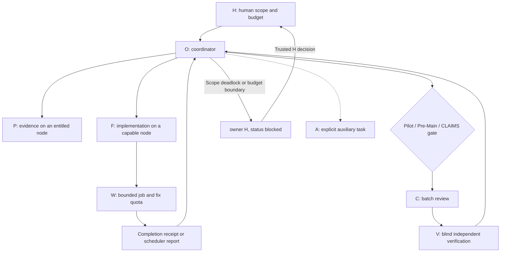

# Governed multi-agent engineering

The optional governed profile adds explicit human authority, milestone review and node-aware handoffs to the basic workflow. All examples are synthetic. The profile describes reusable mechanisms, not a measured performance claim or a production security boundary.

Introduced in toolkit v0.2.0; see the [changelog and upgrade notes](../CHANGELOG.md).

## Before versus after

The "before" column describes failure-prone operating patterns, not a benchmark of this toolkit's previous release. The basic dispatcher already polled files without idle model calls; the new mode adds event/gate eligibility and does not by itself establish further token savings.

| Failure mode | Before | After | Evidence to check |
|---|---|---|---|
| Decision deadlock | O/C exchange objections without a final owner | One bounded debate, then `owner: H`, blocked; explicit H decision and reassignment close the loop | Gate remains idle; trusted decision reference and release exist |
| Agent overreach | Consensus or a reviewer implicitly overrides the user | H controls project scope/budget; O/F production ownership; W repair allowance; waivers separate from evidence | No H model dispatch, quota ledger and isolated reviewed repair commit |
| Idle token waste | Scheduled model wakes and repeated micro-reviews | External event receipts, shell-only readiness checks and three batched C/V gates | Idle model calls, cost and latency measured under matched workload |
| Wrong physical node | A model is assumed to have every tool/network entitlement | Capability contract, fresh preflight and exact node routing | Mismatched node produces no dispatch; capability proof is current |
| Migration race | Both hosts resume or neither confirms startup | Quiesce, state push, target READY, lease transfer, target STARTED | One writer and matching revision/artifact hashes across acknowledgments |
| Correlated verification | V reuses the author's implementation or parser | Minimal binary/schema packet, independent sealed script, comparison only afterward | No implementation exposure; verifier revision and artifact checksums recorded |

H waiting is deliberate blocking, not automatic deadlock resolution: progress still requires an actual human decision. Milestone Mode reduces opportunities for waste; this repository has no matched-workload benchmark establishing an 80% saving. Distributed leases, role write ACLs, node identity and event/human authentication need host/project controls beyond the local dispatcher.

## Pattern modules

- [H authority and gate state machine](../skills/engineering-governance/references/human-gate.md)
- [Milestone events, review gates and token accounting](../skills/engineering-governance/references/milestone-mode.md)
- [Node capability contracts and migration SOP](../skills/engineering-governance/references/node-affinity.md)
- [Roles, task-level fix quota and blind verification](../skills/engineering-governance/references/role-boundaries.md)

Start with the [governance skill](../skills/engineering-governance/SKILL.md). Copy [GOVERNANCE.md](../templates/project/context/GOVERNANCE.md), [NODES.md](../templates/project/context/NODES.md) and [HANDOFF.md](../templates/project/context/HANDOFF.md) when adopting the profile. Do not copy private environment facts into a public repository.
