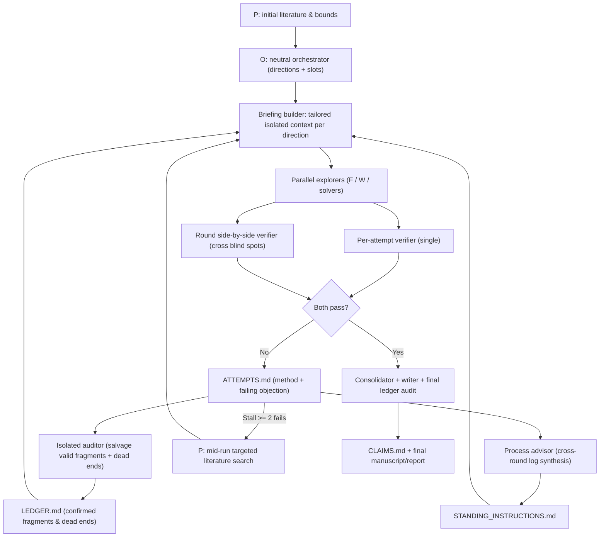

# Iterative research harness

For routine code changes, use basic routing (`O -> I -> C`). For high-cost multi-host batch pipelines, add the [governed profile](governance.md). When a project tackles an **open research problem, proof discovery or puzzling model mismatch** where single-shot attempts keep stalling or diverging, use the **iterative research harness** ([research-harness skill](../skills/research-harness/SKILL.md)).

## Architecture overview

## Four additions over the base workflow

1. **Neutral orchestration and per-direction briefings:** Explorers do not ingest the entire noisy discussion archive. Each direction gets a tailored briefing containing only active standing guardrails, reusable verified fragments, relevant excluded dead ends and prior objections for that direction ([briefing guide](../skills/research-harness/references/briefing-and-ledger.md)).
2. **Dual-scope adversarial verification:** Passing requires clearing both an isolated single-attempt check and a round-wide side-by-side comparison designed to catch assumptions shared across multiple attempts ([verification protocol](../skills/research-harness/references/dual-verification-and-advisor.md)).
3. **Separated intermediate ledger (`ATTEMPTS.md` + `LEDGER.md`):** Failed runs retain value. An independent auditor extracts valid sub-results from failed drafts, verifies each fragment in isolation and logs falsified regimes as dead ends with explicit revisit conditions before headline outcomes enter [CLAIMS.md](../templates/project/context/CLAIMS.md).
4. **Cross-round process advisor (`STANDING_INSTRUCTIONS.md`):** A separate advisor pass inspects multi-round failure logs and verifier disagreements to update procedural guardrails, and triggers mid-run literature re-dispatch when a direction stalls on the same objection.

## Templates and local state helper

- Starter project records: [ATTEMPTS.md](../templates/project/context/ATTEMPTS.md), [LEDGER.md](../templates/project/context/LEDGER.md), [STANDING_INSTRUCTIONS.md](../templates/project/context/STANDING_INSTRUCTIONS.md).
- Zero-dependency helper: [harness_ledger.py](../skills/research-harness/scripts/harness_ledger.py) validates dual-verifier pass gates, non-self-verified fragment promotion, mandatory failure objections, stall detection and per-direction briefing generation.

See [workflow.md](workflow.md) for base thread routing rules.
