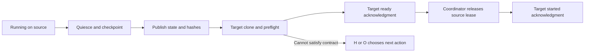

# Physical-node affinity and migration

## Capability, not model brand

Bind a task to verified physical capabilities: authorized network access, a locally usable tool license, CPU/GPU support, memory, storage and runtime compatibility. Never infer an entitlement from a model name, hostname or an earlier node's success. P's full-text retrieval runs on an entitled node when required; F's compute runs on a suitably provisioned node; W's scheduling can use a lower-resource node. Do not publish real hostnames, private IPs, entitlement details, credentials or personal paths in shared templates. Network access is not permission to bypass access controls or redistribute restricted content.

Keep a local node registry based on `templates/project/context/NODES.md`. At assignment, O/F records the task ID, required capabilities, preflight evidence/time, assigned node, input revision and artifact inventory. Verify licenses noninteractively and run a small representative check. If the node cannot satisfy the contract, stop and request migration rather than silently changing tools, precision, inputs or algorithms. A node label is routing, not proof of capability.

## Migration state machine

1. **Quiesce.** Stop new launches and checkpoint at a supported safe boundary. Confirm the writer has stopped before synchronizing files. If no portable checkpoint exists, say so; plan a new run rather than pretend to resume.
2. **Publish state.** Record a handoff ID, source task/lease, revision, input/parameter hashes, checkpoint/log hashes, environment, failure reason, remaining work and budget. Stage files by name, commit and push through the project's authorized integration route. Keep large/restricted binaries in the approved artifact store with immutable IDs; Git carries only allowed state and manifests. Never copy credentials or machine-specific caches.
3. **Target preparation.** The target uses its own clone/worktree, fetches the named revision and artifacts, checks hashes and independently repeats capability/preflight checks. Do not pull into a directory with a live writer. Confirm checkpoint/runtime compatibility; moving a run to different hardware is not numerical equivalence.
4. **Ready acknowledgment.** Target appends READY with handoff ID, node label, accepted revision/hashes, preflight result and capacity. It does not start computing yet.
5. **Single-writer transfer.** O confirms source quiescence and releases its lease, records the new lease holder, and authorizes start. Target emits STARTED with the same handoff ID and run ID. Until this acknowledgment, do not mark migration complete. Local dispatcher locks do not replace this distributed lease.
6. **Failure or rollback.** If readiness/start acknowledgment is missing by the agreed deadline, mark blocked and let O inspect target processes and artifacts before resuming anywhere. Never run the source and target concurrently on the same checkpoint. A material capability/budget change goes to H. Claims crossing hardware require independent parity evidence or explicit limitations.

Commit/entry examples: `O: checkpoint task-17 for handoff-4`; `P: READY handoff-4 on access-node`; `W: STARTED handoff-4 run-18`. Use only synthetic node labels in public examples.

For local dispatch, `node: access-node` requires `--node access-node`. Without that matching label, preview and execution skip the thread. The dispatcher does not discover hardware, authenticate host identity, migrate sessions, transfer artifacts or verify licenses; node preflight and the two-phase lease transfer are project procedures.
